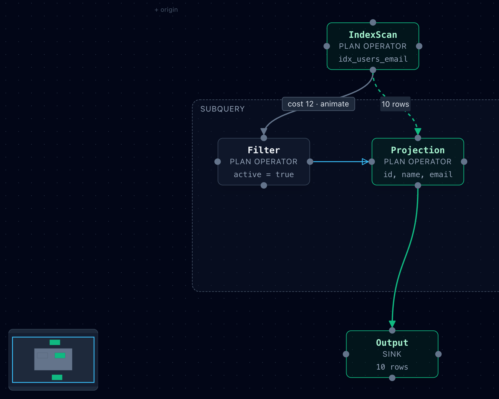
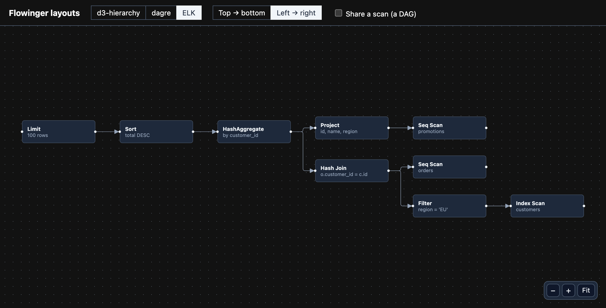
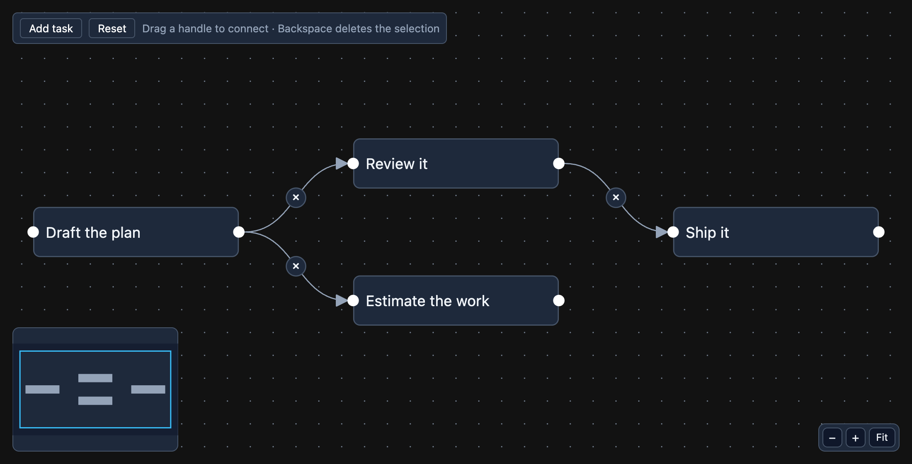
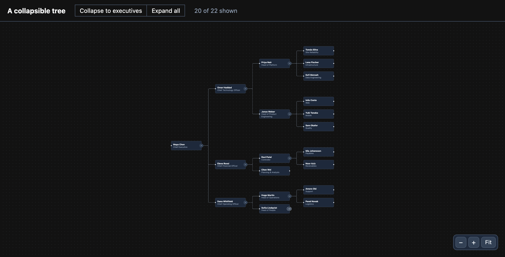

<h1 align="center">Flowinger</h1>

<p align="center">
  <strong>A small, dependency-free node-graph renderer for React.</strong><br />
  HTML nodes over SVG edges, with pan, zoom, drag and connect — and an API shaped like React Flow's.
</p>

<p align="center">
  <a href="https://www.npmjs.com/package/flowinger"></a>
  <a href="https://github.com/Naveen-Boddepalli/flowinger/actions/workflows/ci.yml"></a>
  <a href="docs/features.md"></a>
  
  <a href="https://www.npmjs.com/package/flowinger"></a>
  <a href="LICENSE.md"></a>
</p>

<p align="center">
  <a href="https://naveen-boddepalli.github.io/flowinger/"><strong>Live demo</strong></a> ·
  <a href="docs/README.md">Documentation</a> ·
  <a href="examples">Examples</a> ·
  <a href="docs/migrating-from-react-flow.md">Migrating from React Flow</a> ·
  <a href="CHANGELOG.md">Changelog</a> ·
  <a href="ROADMAP.md">Roadmap</a>
</p>

<p align="center">
  
</p>

> **Status:** `0.x`. It is what [QueryLens](https://github.com/Naveen-Boddepalli/QueryLens) draws its diagrams
> with, and its API follows React Flow's — but a minor release can still change it, and the
> [changelog](CHANGELOG.md) says when it does. These docs describe `main`; what is newer than the latest npm
> release is listed under *Unreleased* there.

## Why Flowinger

- **Small, and only what you use.** The core is about 18.9 kB gzipped; drag, connect, selection and the rest are
  opt-in features that add only their own code, so the whole canvas is about 33.9 kB. In QueryLens, swapping
  React Flow for it took the diagram chunk from **60.5 kB to 19.0 kB** gzipped.
- **No dependencies.** `react` and `react-dom` (18 or 19) are the only peers. Plain DOM, SVG and CSS.
- **Your components are the nodes.** Anything you can render in a `div` is a node; handles are measured where
  they are really drawn, so an edge follows a handle you moved with CSS.
- **An API you already know.** React Flow's names for components, hooks, props, class names, `data-testid`s and
  types — all [211 of its exports](docs/react-flow-coverage.md), and **every one of the 302 members** of the props,
  instance and components you write against *does something* (the audit counts a name that compiles and does
  nothing apart, and there are none) — measured from its own type declarations, with a
  [migration guide](docs/migrating-from-react-flow.md) for the defaults that differ.
- **The "pro" extras, free.** [Undo/redo, copy and paste, snap guides, export, smart edges, flowchart shapes
  and a collapsible tree](docs/pro.md), each its own entry point (`flowinger/history`…), so they cost the core
  nothing unless you import them.
- **Server rendering that works.** Renders and hydrates on React 18 and 19, with the first paint already framed.
- **Accessible when you ask.** Keyboard navigation, focusable nodes and edges, ARIA fields — opt-in, so a page
  that only shows a diagram does not gain tab stops it did not want.
- **Tested against the real thing.** More than 1,000 unit tests (React Flow itself is the oracle for geometry and
  behaviour), mutation-tested guards, a real-browser suite, and CI that installs the *packed* package.

## At a glance: Flowinger and React Flow

| | Flowinger | React Flow (`@xyflow/react` 12) |
|---|---|---|
| Runtime dependencies | **0** | 3 direct (`@xyflow/system`, `zustand`, `classcat`), plus `d3-zoom`, `d3-drag`, `d3-selection`… through `@xyflow/system` |
| Stylesheet to import | **None** (CSS variables) | `@xyflow/react/dist/style.css` |
| Diagram chunk in a real app ([QueryLens](https://github.com/Naveen-Boddepalli/QueryLens)) | **19.0 kB** gzipped | 60.5 kB gzipped |
| Mount 10,000 nodes ([benchmarks](docs/benchmarks.md)) | **0.6 s** | 1.3 s |
| Pan / zoom 10,000 nodes, no culling | **9 / 10.5 ms** a frame | 33 / 34 ms a frame |
| Pan / zoom / drag 10,000 nodes, culled | 4.5 / 5.5 / 7.7 ms | **4.3 / 4.8 / 4.7 ms** |
| Undo/redo, copy-paste, snap lines, export, smart edges | **Free**, separate entry points | [React Flow Pro](https://reactflow.dev/pro) examples (paid subscription) |
| API | React Flow's names: 211 of 211 exports, 119 of 119 props | — |
| Ecosystem, examples, answers online | Small and new | **Large and mature** |

The culled row is where React Flow is still ahead; closing it is on the [roadmap](ROADMAP.md).

## Install

```bash
npm install flowinger      # or: pnpm add flowinger · yarn add flowinger
```

React 18 or 19 is a peer dependency. The package ships ESM, CommonJS and TypeScript declarations for both.

## Quick start

```tsx
import {
  Background, Controls, FlowingerCanvas, FlowingerProvider, Handle, Position,
  type Edge, type Node, type NodeProps,
} from 'flowinger';

function Step({ data }: NodeProps) {
  return (
    <div className="step">
      <Handle id="in" type="target" position={Position.Top} />
      {String(data.label)}
      <Handle id="out" type="source" position={Position.Bottom} />
    </div>
  );
}

// Defined outside the component, so they keep their identity between renders.
const nodeTypes = { step: Step };
const nodes: Node[] = [
  { id: 'a', type: 'step', position: { x: 0, y: 0 }, data: { label: 'Scan' } },
  { id: 'b', type: 'step', position: { x: 0, y: 120 }, data: { label: 'Filter' } },
];
const edges: Edge[] = [
  { id: 'a-b', source: 'a', target: 'b', sourceHandle: 'out', targetHandle: 'in', markerEnd: 'arrowclosed' },
];

export function Diagram() {
  return (
    // The canvas fills its parent, so the parent needs a height.
    <div style={{ position: 'relative', height: 400 }}>
      <FlowingerProvider>
        <FlowingerCanvas nodes={nodes} edges={edges} nodeTypes={nodeTypes}>
          <Background />
        </FlowingerCanvas>
        <Controls style={{ position: 'absolute', right: 12, bottom: 12 }} />
      </FlowingerProvider>
    </div>
  );
}
```

That draws a diagram you can pan and zoom. **Nothing is draggable, connectable or selectable until you say
so** — React Flow turns those on by default, Flowinger leaves them off — so an editor opts in:

```tsx
const [nodes, setNodes, onNodesChange] = useNodesState(initialNodes);
const [edges, setEdges, onEdgesChange] = useEdgesState(initialEdges);

<FlowingerCanvas
  nodes={nodes}
  edges={edges}
  onNodesChange={onNodesChange}
  onEdgesChange={onEdgesChange}
  onConnect={(connection) => setEdges((current) => addEdge(connection, current))}
  nodesDraggable
  nodesConnectable
  elementsSelectable
/>
```

More in [Getting started](docs/getting-started.md), or run the [examples](examples).

## Pay for what you use

`FlowingerCanvas` (also exported as `ReactFlow`) has every feature and is what most apps want. An app that only
*shows* a graph needs far less, so the canvas is a small core plus **features**, and you import the ones you use:

```tsx
import { FlowingerCore, connectFeature, dragFeature } from 'flowinger';

<FlowingerCore
  nodes={nodes} edges={edges}
  features={[dragFeature, connectFeature]}
  nodesDraggable nodesConnectable
/>
```

| Build | Gzipped |
|---|---|
| `FlowingerCore`, no features | about 18.9 kB |
| …plus each feature you name | only its own code |
| `FlowingerCanvas`, every feature | about 33.9 kB |

Both are held by budgets in CI, measured on a small consumer's real bundle. A prop for a feature the canvas
lacks does nothing — and in development the console says so. See [Features](docs/features.md).

## Documentation

| | |
|---|---|
| [Getting started](docs/getting-started.md) | Install, a first diagram, making it interactive, and the first things that trip people |
| [API reference](docs/api.md) | Canvas props, nodes and edges, handles, sub-flows, the instance, controlled flows |
| [Components and hooks](docs/components.md) | `Handle`, `Background`, `Controls`, `MiniMap`, `NodeToolbar`, `NodeResizer`, `useReactFlow`… |
| [Features](docs/features.md) | What each feature adds, what needs it, and how to write your own |
| [The "pro" modules](docs/pro.md) | Undo/redo, copy and paste, snap guides, export, smart edges, shapes, a collapsible tree |
| [Theming](docs/theming.md) | The `--flowinger-*` CSS variables |
| [Server rendering](docs/server-rendering.md) | What renders on the server and what waits for the client |
| [Migrating from React Flow](docs/migrating-from-react-flow.md) | Defaults, types, what is missing and what to do instead |
| [React Flow coverage](docs/react-flow-coverage.md) | How much of its API this covers, measured |
| [Benchmarks](docs/benchmarks.md) | Mount, pan, zoom and drag against React Flow at 1,000–10,000 nodes, and how to re-run them |

## Examples

<table>
  <tr>
    <td width="50%">
      <a href="examples/layouts"></a>
    </td>
    <td width="50%">
      <a href="examples/editor"></a>
    </td>
  </tr>
  <tr>
    <td><a href="examples/layouts"><strong>Layouts</strong></a> — one query plan laid out by <code>d3-hierarchy</code>, <code>dagre</code> and <code>elkjs</code> behind a single signature. Positions are yours; this is how you get them.</td>
    <td><a href="examples/editor"><strong>Editor</strong></a> — a controlled editor: drag, connect, select, delete, snap to a grid, a custom node and a custom edge.</td>
  </tr>
  <tr>
    <td>
      <a href="examples/tree"></a>
    </td>
    <td valign="top"><a href="examples/tree"><strong>Tree</strong></a> — an org chart whose branches fold: <code>useCollapsibleTree</code> from <code>flowinger/tree</code> hides what is under a node, and the layout runs again over what is left so the tree closes up.</td>
  </tr>
</table>

Each is a complete Vite + React + TypeScript project you can copy out and run, and CI builds each one against
the packed library on every pull request. To try one in the browser with nothing installed, open it in
StackBlitz: [layouts](https://stackblitz.com/github/Naveen-Boddepalli/flowinger/tree/main/examples/layouts) ·
[editor](https://stackblitz.com/github/Naveen-Boddepalli/flowinger/tree/main/examples/editor) ·
[tree](https://stackblitz.com/github/Naveen-Boddepalli/flowinger/tree/main/examples/tree).

## Is it for you?

**Reach for Flowinger when** your app *draws a graph* — a query plan, a syntax tree, a dependency map, a
workflow — and what it costs matters: the bundle, the dependencies, the markup.

**Reach for [React Flow](https://reactflow.dev) instead when** you need something on the
[missing list](docs/react-flow-coverage.md) and cannot wait for it, or you want its larger ecosystem of
examples, templates and answers. Flowinger is not a drop-in for all of React Flow, and does not try to be: it
covers the part of the API that apps like the one above use, and says plainly where it stops.

**Neither library lays a graph out for you.** Feed `x` / `y` from [`d3-hierarchy`](https://d3js.org/d3-hierarchy),
[`dagre`](https://github.com/dagrejs/dagre) or [`elkjs`](https://github.com/kieler/elkjs) — the
[layouts example](examples/layouts) does all three.

## Compatibility

| | |
|---|---|
| **React** | 18 and 19, both tested in CI |
| **Modules** | ESM and CommonJS, with TypeScript declarations for each (checked with publint and Are the Types Wrong) |
| **Rendering** | Client, server and hydration (`react-dom/server`) |
| **Browsers** | Current evergreen browsers — pointer events, `ResizeObserver`. The browser suite runs in Chromium; two-finger touch pinch is unit-tested but not yet seen on a physical device ([roadmap](ROADMAP.md)) |

## Contributing

Bug reports, a repro of something React Flow does differently, layout recipes and examples are all welcome.
Start with [CONTRIBUTING.md](CONTRIBUTING.md) — it says what fits, what "done" means here, and how to run
everything:

```bash
pnpm install
pnpm dev                 # the demo
pnpm test                # unit tests
pnpm e2e                 # the real-browser suite (Playwright)
pnpm check:package       # publint + Are the Types Wrong on the packed tarball
```

By taking part you agree to the [Code of Conduct](CODE_OF_CONDUCT.md). Security issues go to
[SECURITY.md](SECURITY.md), not a public issue. [`plan.md`](plan.md) is the design record: what was built, what
was measured, and what was tried and dropped.

## Acknowledgements

Flowinger's API follows [React Flow](https://reactflow.dev) by [xyflow](https://xyflow.com), and was built to match
its *behaviour* — by running it, reading its published types, and using it as a test oracle. A few formulas
(the bezier control points and where a label sits on the curve) are adapted from it under its MIT licence and
credited in [NOTICE.md](NOTICE.md).

## License

[MIT](LICENSE.md) © Naveen Boddepalli
