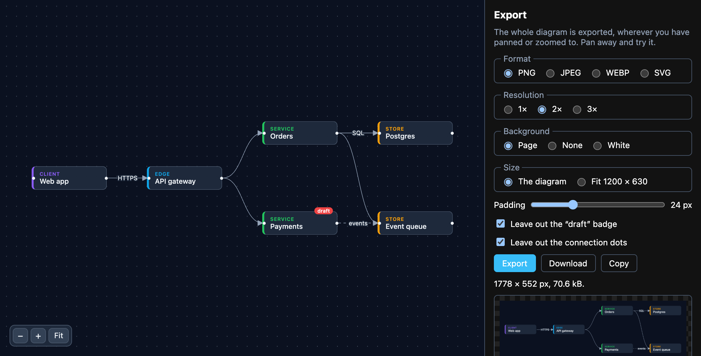
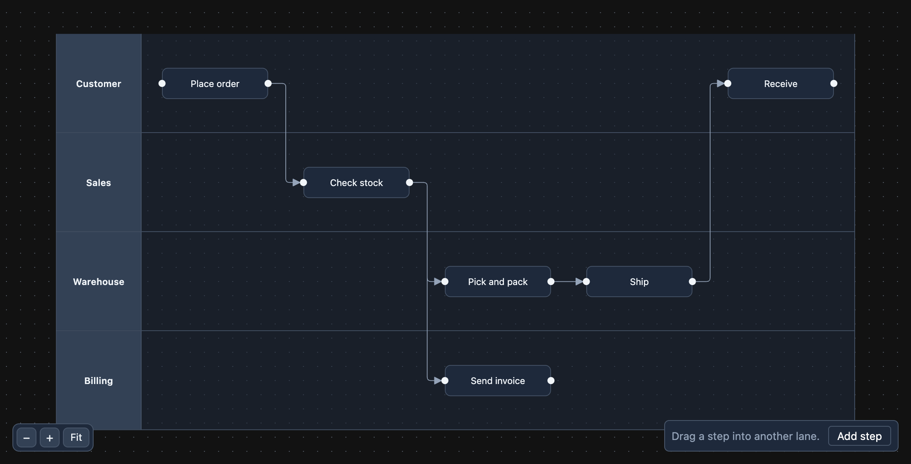
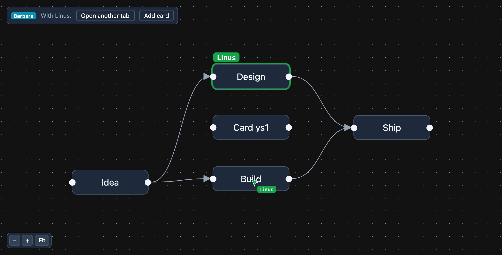
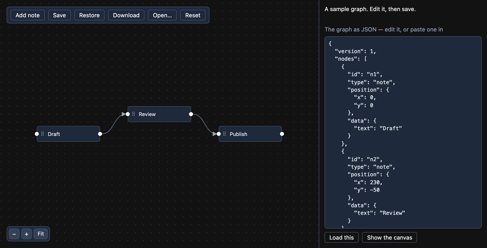

# Examples

Eight small apps, each a complete React + TypeScript project you can copy out of this repository and run:
`pnpm install && pnpm dev` (or `npm install && npm run dev`). Seven are Vite apps; one is Next.js.

| | What it shows |
|---|---|
| [`export`](export) | **The diagram as an image** with `flowinger/export`: PNG, JPEG, WebP or SVG, at 1–3× resolution, on the page's background, none, or white, as the whole diagram or fitted to a 1200 × 630 social card — then previewed, downloaded, or copied to the clipboard. The whole diagram is drawn wherever the view is panned to. Nodes styled by class come out as they look, because the page's style sheets go into the image, and `filter` leaves out what should not (a "draft" badge, the connection dots). |
| [`layouts`](layouts) | A **read-only viewer** on `FlowingerCore` (no features, the small build). One query plan laid out three ways — [`d3-hierarchy`](https://d3js.org/d3-hierarchy), [`dagre`](https://github.com/dagrejs/dagre) and [`elkjs`](https://github.com/kieler/elkjs) — top-to-bottom or left-to-right, as a tree or as a DAG. The part to read is [`src/layout.ts`](layouts/src/layout.ts): three functions with one signature, each returning `{ [id]: { x, y} }`. |
| [`editor`](editor) | A **controlled editor** on `FlowingerCanvas`: drag, connect, select, delete, snap to a grid, a mini-map; a custom node with an input that does not drag it, and a custom edge with a button on it (`BaseEdge` + `EdgeLabelRenderer`). |
| [`nextjs`](nextjs) | **Server rendering in Next.js** (App Router). A Server Component builds a pipeline, lays it out and works out the viewport with flowinger's own `viewportForBounds`, so the HTML arrives framed and nothing moves on load. Then the same graph as a viewer and as an editor with undo. The parts to read: [`app/pipeline.ts`](nextjs/app/pipeline.ts) (server-only) and [`app/Viewer.tsx`](nextjs/app/Viewer.tsx) (why it is a client component). |
| [`presence`](presence) | **Multiplayer, with Yjs**: the graph is a shared Yjs document, so a drag, a new card, a connection or a delete in one tab appears in every other; and each person's pointer and selection are shared through Yjs awareness — cursors drawn in graph units (so they sit on the same node whatever your pan and zoom), and a ring and name tag on what someone else has selected. It syncs browser tabs over a `BroadcastChannel`, so it runs with no server: open it twice. [`src/room.ts`](presence/src/room.ts) says what to swap in (`y-websocket`, `y-webrtc`) for people on different machines. |
| [`save-load`](save-load) | **Saving and loading a graph as JSON.** `toObject()` is the graph as it stands — dragged positions, what was typed into a node, the view — so it is what gets saved: in the browser (it comes back after a reload), as a downloaded `.json` file, or as text you can edit and load. The part to read is [`src/flowFile.ts`](save-load/src/flowFile.ts): it checks a file somebody else wrote (ids, positions, edges that point at real nodes) and says what is wrong instead of handing the canvas something it cannot draw. |
| [`swimlanes`](swimlanes) | **A process in swimlanes**: each lane a parent node, each step a child of its lane (`parentId`), so a step's position is relative to its lane and it moves with it. Drag a step into another lane and it *changes* lanes: on `onNodeDragStop` the lane under its centre becomes its parent and its position is re-based on that lane, so it stays where it was dropped; dropped outside every lane it goes back into the nearest. The lane it would land in lights up during the drag. |
| [`tree`](tree) | An **org chart with collapsible branches**, on `FlowingerCore` and `flowinger/tree`. Each node has a button that folds everything under it; the tree closes up around what is hidden. The parts to read: [`useCollapsibleTree`](tree/src/App.tsx) called once and handed to the nodes by context, and [`layoutShown`](tree/src/layout.ts), which runs the layout again over only what is shown. |

<table>
  <tr>
    <td width="50%"> <b>layouts</b></td>
    <td width="50%"> <b>editor</b></td>
  </tr>
  <tr>
    <td> <b>export</b></td>
    <td> <b>swimlanes</b></td>
  </tr>
  <tr>
    <td> <b>presence</b></td>
    <td></td>
  </tr>
  <tr>
    <td> <b>save-load</b></td>
    <td> <b>tree</b></td>
  </tr>
</table>

Open one without installing anything, once the repository is public:
[`layouts`](https://stackblitz.com/github/Naveen-Boddepalli/flowinger/tree/main/examples/layouts) ·
[`editor`](https://stackblitz.com/github/Naveen-Boddepalli/flowinger/tree/main/examples/editor) ·
[`export`](https://stackblitz.com/github/Naveen-Boddepalli/flowinger/tree/main/examples/export) ·
[`presence`](https://stackblitz.com/github/Naveen-Boddepalli/flowinger/tree/main/examples/presence) ·
[`save-load`](https://stackblitz.com/github/Naveen-Boddepalli/flowinger/tree/main/examples/save-load) ·
[`swimlanes`](https://stackblitz.com/github/Naveen-Boddepalli/flowinger/tree/main/examples/swimlanes) ·
[`tree`](https://stackblitz.com/github/Naveen-Boddepalli/flowinger/tree/main/examples/tree) ·
[`nextjs`](https://stackblitz.com/github/Naveen-Boddepalli/flowinger/tree/main/examples/nextjs).

## Notes

- **Layout is yours.** Flowinger draws what it is given; none of the three layout libraries is a dependency
  of it. A layout needs each node's size before anything is drawn, so `layouts` gives every node a fixed one
  (and says what to do when the content decides — see the comment at the top of `layout.ts`).
- **They use the released package** (`flowinger` from the registry), and only API that release has, so a
  copied folder works as it is. The repository's CI builds each one against the *packed* library on every
  pull request (`node scripts/check-examples.mjs`), so an example that stops compiling fails the change that
  broke it.
- **`pnpm-workspace.yaml`** in each folder allows `esbuild`'s install script: pnpm 10 and later skip a
  dependency's script until it is allowed, and report the skipped one as an error. npm and Yarn need
  nothing.
- **`nextjs` uses Next.js 16**, with nothing configured: no stylesheet to import, and no `transpilePackages`.
- **Vite 6, not the repository's own Vite 8**, on purpose: these are meant to open in StackBlitz, whose
  in-browser runtime has the longest track record with Vite 5 and 6. (Not tested there from this
  repository — it is a hosted service that needs the repository public.)
